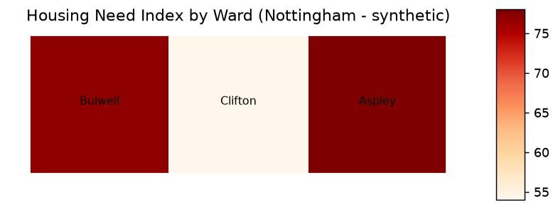

# Nottingham Housing GIS & Analytics

A small, end-to-end geospatial pipeline that builds, quality-checks and analyses
housing data by ward, then produces a map and a dashboard-ready summary.
Built in Python with GeoPandas.

> Portfolio project by **Isak Sam Raju**. It demonstrates the core workflow of a
> local-authority Housing Services GIS Analyst. The data is **synthetic** (a simple
> stand-in so the pipeline can run end to end) and the ward shapes are simplified
> squares, not real Nottingham boundaries. A real-data version using ONS ward
> boundaries is in progress.

## What it produces



## The pipeline

- **`src/generate_data.py`** — builds three spatial layers in British National Grid
  (EPSG:27700): wards (polygons), housing-land parcels (polygons) and council
  property assets (points), all linked by `ward_code`.
- **`src/quality_checks.py`** — data-quality / governance checks: coordinate system,
  missing values, and referential integrity (no parcel or asset points to a ward
  that doesn't exist).
- **`src/analysis.py`** — joins the layers by ward, writes a per-ward summary CSV
  (`outputs/ward_summary.csv`) and the housing-need choropleth map above.

## How to run

```bash
pip install -r requirements.txt
python src/generate_data.py     # build the layers
python src/quality_checks.py    # run the QA report
python src/analysis.py          # build the map + summary CSV
```

## Skills demonstrated

GIS data management · spatial data quality & governance · coordinate systems
(EPSG:27700) · multi-source spatial joins · choropleth mapping · Python
(GeoPandas, Shapely) · reproducible pipeline.

## Honest scope

The data is synthetic and the ward geometry is simplified — the point is to show
the workflow, not to publish real figures. A production version would use the
council's own land, asset and housing-need data on real ward boundaries.

## Licence

MIT
